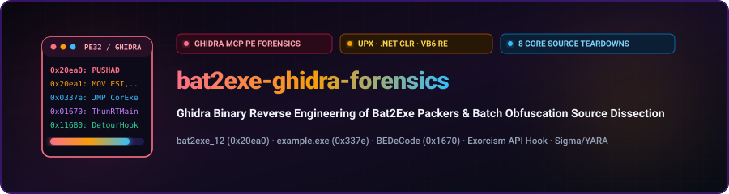
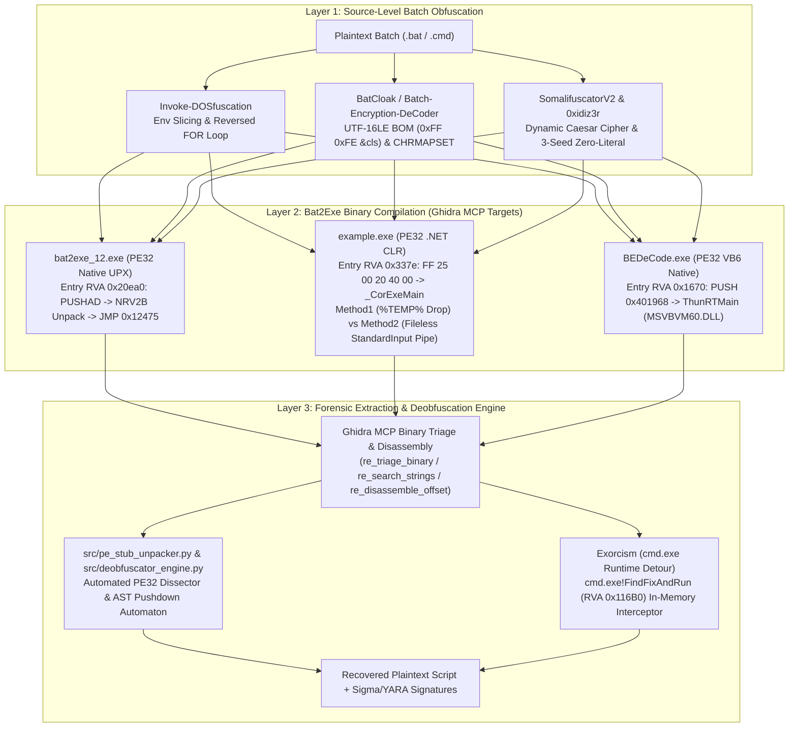

<div align="center">

<p align="center">
  <strong>🇺🇸 English</strong> · <a href="./docs/locales/ko.md">🇰🇷 한국어</a> · <a href="./docs/locales/zh-CN.md">🇨🇳 中文</a> · <a href="./docs/locales/es.md">🇪🇸 Español</a> · <a href="./docs/locales/hi.md">🇮🇳 हिन्दी</a><br />
  <a href="./docs/locales/ar.md">🇸🇦 العربية</a> · <a href="./docs/locales/pt-BR.md">🇧🇷 Português</a> · <a href="./docs/locales/ru.md">🇷🇺 Русский</a> · <a href="./docs/locales/fr.md">🇫🇷 Français</a> · <a href="./docs/locales/id.md">🇮🇩 Bahasa Indonesia</a>
</p>

<p align="center">
  <a href="https://github.com/maya-thorne/bat2exe-ghidra-forensics"></a>
</p>

# 🔬 bat2exe-ghidra-forensics

**Ghidra Binary Reverse Engineering of Bat2Exe Packers & Batch Obfuscation Source Dissection**

[](./docs/whitepapers/DEEP_REVERSE_ENGINEERING_AND_SOURCE_ANALYSIS.md)
[](./docs/whitepapers/BATCH_OBFUSCATION_ARCHITECTURE_AND_CODE_ANALYSIS.md)
[](./src/pe_stub_unpacker.py)
[](./LICENSE)
[](https://github.com/maya-thorne/bat2exe-ghidra-forensics)

<sub>Engineered &amp; Audited by **[Maya Thorne](https://github.com/maya-thorne)** · Binary Forensics &amp; Systems Reverse Engineering</sub>

</div>

---

## 📑 Executive Summary & Master Whitepapers (핵심 역공학 백서 색인)

<table width="100%">
  <thead>
    <tr>
      <th width="6%" align="center">#</th>
      <th width="30%" align="left">📄 Document / Artifact</th>
      <th width="54%" align="left">🔬 Core Scope &amp; Forensic Coverage</th>
      <th width="10%" align="center">📦 Size</th>
    </tr>
  </thead>
  <tbody>
    <tr>
      <td align="center"><strong>1</strong></td>
      <td>
        🔬 <strong><a href="./docs/whitepapers/DEEP_REVERSE_ENGINEERING_AND_SOURCE_ANALYSIS.md">Deep Reverse Engineering</a></strong><br>
        <code>DEEP_REVERSE_<wbr>ENGINEERING_<wbr>AND_SOURCE_ANALYSIS.md</code>
      </td>
      <td>
        <strong>Ghidra MCP PE Binary Disassembly</strong> (<code>bat2exe_12.exe</code>, <code>example.exe</code>, <code>BEDeCode.exe</code>) + <strong>Line-by-Line Source Code Teardown of 8 Core Tools</strong> (<code>Bat2Exe-dehoisted</code>, <code>Batch-Encryption-DeCoder</code>, <code>BatCloak</code>, <code>Invoke-DOSfuscation</code>, <code>SomalifuscatorV2</code>, <code>0xidiz3r</code>, <code>batch_deobfuscator</code>, <code>Exorcism</code>).
      </td>
      <td align="center"><strong>42.8 KB</strong></td>
    </tr>
    <tr>
      <td align="center"><strong>2</strong></td>
      <td>
        🏗️ <strong><a href="./docs/whitepapers/BATCH_OBFUSCATION_ARCHITECTURE_AND_CODE_ANALYSIS.md">Architecture &amp; Code Analysis</a></strong><br>
        <code>BATCH_OBFUSCATION_<wbr>ARCHITECTURE_<wbr>AND_CODE_ANALYSIS.md</code>
      </td>
      <td>
        <strong>Architectural Taxonomy &amp; Parser Mechanics</strong>: <code>cmd.exe</code> 5-Phase Expansion Order, Polyglot Header Exploitation, Pushdown Automaton AST Reconstruction, API Hooking (<code>FindFixAndRun</code>).
      </td>
      <td align="center"><strong>43.7 KB</strong></td>
    </tr>
    <tr>
      <td align="center"><strong>3</strong></td>
      <td>
        ⚙️ <strong><a href="./docs/whitepapers/GHIDRA_BINARY_RE_AND_DEOBFUSCATOR_ENGINE_ANALYSIS.md">Binary RE &amp; Deobfuscator Engine</a></strong><br>
        <code>GHIDRA_BINARY_RE_<wbr>AND_DEOBFUSCATOR_<wbr>ENGINE_ANALYSIS.md</code>
      </td>
      <td>
        <strong>Static &amp; Dynamic Unpacking Pipeline</strong>: PE Overlay Extraction, CLR <code>#US</code> Stream Recovery, Multi-Pass Regex/AST Deobfuscation Engine (<code>src/deobfuscator_engine.py</code>).
      </td>
      <td align="center"><strong>44.4 KB</strong></td>
    </tr>
    <tr>
      <td align="center"><strong>4</strong></td>
      <td>
        📖 <strong><a href="./docs/whitepapers/BATCH_OBFUSCATION_ENCYCLOPEDIA.md">Master Encyclopedia (v2.0)</a></strong><br>
        <code>BATCH_OBFUSCATION_<wbr>ENCYCLOPEDIA.md</code>
      </td>
      <td>
        <strong>48+ Open-Source &amp; Hugging Face Reference Encyclopedia</strong>: Complete classification of obfuscators, compilers, deobfuscators, and ML datasets.
      </td>
      <td align="center"><strong>30.3 KB</strong></td>
    </tr>
    <tr>
      <td align="center"><strong>5</strong></td>
      <td>
        🛡️ <strong><a href="./docs/whitepapers/BATCH_OBFUSCATION_MASTER_GUIDE.md">30-Year Evolution &amp; Guide</a></strong><br>
        <code>BATCH_OBFUSCATION_<wbr>MASTER_GUIDE.md</code>
      </td>
      <td>
        <strong>30-Year Evolution (1990s–2026) &amp; Defense Matrix</strong>: Historical timeline, Mandiant/Unit 42 threat intelligence, production Sigma &amp; YARA rulesets.
      </td>
      <td align="center"><strong>33.6 KB</strong></td>
    </tr>
  </tbody>
</table>

---

## 🖥️ Live Forensics & Decompilation Terminal Demo

<p align="center">
  <a href="https://github.com/maya-thorne/bat2exe-ghidra-forensics">
    
  </a>
</p>

---

## 🧬 End-to-End Binary Packing & Deobfuscation Topology



---

## ⚙️ Automated PE32 Bat2Exe Unpacking Pipeline

<p align="center">
  <a href="https://github.com/maya-thorne/bat2exe-ghidra-forensics">
    
  </a>
</p>

---

## 🔬 x86 Execution State & UPX NRV2B Register Transition Matrix

<p align="center">
  <a href="https://github.com/maya-thorne/bat2exe-ghidra-forensics">
    
  </a>
</p>

---

## 🔍 Ghidra MCP Binary Reverse Engineering Matrix (`ghidra-re-operator`)

All 3 compiled PE32 executables in the archive were dissected using `re_triage_binary`, `re_search_strings`, and `re_disassemble_offset`:

<table width="100%">
  <thead>
    <tr>
      <th width="20%" align="left">🎯 Target Binary</th>
      <th width="16%" align="left">🏗️ Architecture</th>
      <th width="12%" align="center">📍 Entry Point</th>
      <th width="16%" align="left">📊 Sections &amp; Entropy</th>
      <th width="36%" align="left">🔬 Key Disassembly &amp; Runtime Mechanism</th>
    </tr>
  </thead>
  <tbody>
    <tr>
      <td>
        <strong><code>bat2exe_12.exe</code></strong><br>
        <small>(<code>UPX Container</code>)</small>
      </td>
      <td>PE32 x86<br><sub>Windows GUI (<code>2</code>)</sub></td>
      <td align="center"><code>0x20ea0</code></td>
      <td>
        <code>UPX0</code> (<code>0x17000</code>, raw <code>0</code>)<br>
        <code>UPX1</code> (<code>7.89</code> b/B)<br>
        <code>.rsrc</code>
      </td>
      <td>
        <code>0x20ea0: PUSHAD</code> ➔ <code>MOV ESI, 0x417000</code> ➔ <code>LEA EDI, [ESI - 0x16000]</code> ➔ NRV2B bit-stream decompression loop ➔ IAT rebuild (<code>LoadLibraryA</code> / <code>GetProcAddress</code>) ➔ <code>0x20ffd: JMP 0x00412475</code> (OEP).
      </td>
    </tr>
    <tr>
      <td>
        <strong><code>example.exe</code></strong><br>
        <small>(<code>Bat2Exe-dehoisted</code>)</small>
      </td>
      <td>PE32 x86<br><sub>.NET CLR CUI (<code>3</code>)</sub></td>
      <td align="center"><code>0x337e</code></td>
      <td>
        <code>.text</code> (<code>5.64</code>)<br>
        <code>.rsrc</code> (<code>3.99</code>)<br>
        <code>.reloc</code> (<code>0.18</code>)
      </td>
      <td>
        <code>0x337e: FF 25 00 20 40 00 (JMP [0x00402000])</code> ➔ <code>mscoree.dll!_CorExeMain</code>.<br>
        Embeds UTF-16LE user strings at <code>0x143b ("batch_cmd")</code>, <code>0x1465 ("\\temp.bat")</code>, <code>0x1541 ("/c prompt \b &amp; echo on")</code>.
      </td>
    </tr>
    <tr>
      <td>
        <strong><code>BEDeCode.exe</code></strong><br>
        <small>(<code>Batch-Encryption-DeCoder</code>)</small>
      </td>
      <td>PE32 x86<br><sub>VB6 Native GUI (<code>2</code>)</sub></td>
      <td align="center"><code>0x1670</code></td>
      <td>
        <code>.text</code> (<code>5.43</code>)<br>
        <code>.data</code> (<code>0.00</code>)<br>
        <code>.rsrc</code> (<code>3.55</code>)
      </td>
      <td>
        <code>0x1670: 68 68 19 40 00 (PUSH 0x401968)</code> ➔ <code>E8 EF FF FF FF (CALL ThunRTMain)</code> in <code>MSVBVM60.DLL</code>.<br>
        Implements <code>CmdCode_Click</code> (<code>%%a</code> + <code>CHRMAPSET</code>) and <code>CmdDeCode_Click</code> (<code>Replace(txt, "%", "")</code>).
      </td>
    </tr>
  </tbody>
</table>

---

## 🛠️ 8 Core Tools Source Code Dissection Summary

1. **[`Bat2Exe-dehoisted`](./references/batch_corpus_28/Bat2Exe-dehoisted)** (`Batch2Exe.MainWindow` & `CMethods.cs`):
   - Uses `CSharpCodeProvider.CompileAssemblyFromSource` to dynamically compile an in-memory stub with embedded resource `batch_cmd`.
   - Compares **`Method1` (Disk Drop to `%TEMP%\temp.bat`)** vs **`Method2` (Fileless Pipe Injection via `RedirectStandardInput = true` + `StandardInput.WriteLine`)**.
2. **[`Batch-Encryption-DeCoder`](./references/batch_corpus_28/Batch-Encryption-DeCoder)** (`frmMain.frm`):
   - Dissects the VB6 `CHRMAPSET` lookup table, `@echo off & SetLocal EnableDelayedExpansion` header validation, and 2-stage reversal algorithm.
3. **[`BatCloak`](./references/batch_corpus_28/BatCloak)**:
   - Exploits the **UTF-16LE BOM Polyglot (`0xFF 0xFE 26 63 6C 73 0D 0A` = `??&cls`)**: text editors decode garbage CJK glyphs while `cmd.exe` runs in Single-Byte ANSI mode, fails on `0xFF 0xFE`, executes `&cls`, and evaluates the remainder.
4. **[`Invoke-DOSfuscation`](./references/batch_corpus_28/Invoke-DOSfuscation)** (Mandiant / Daniel Bohannon):
   - Formalizes `cmd.exe` AST token-layer vs character-layer obfuscation, zero-alphabetic environment slicing (`%COMSPEC:~-1%`), and reversed `FOR /L` execution loops.
5. **[`SomalifuscatorV2`](./references/batch_corpus_28/SomalifuscatorV2)**:
   - Combines dynamic Caesar cipher environment tables, UTF-16LE BOM headers, fake `certutil` X.509 certificate padding, and anti-VM/anti-sandbox traps.
6. **[`0xidiz3r`](./references/batch_corpus_28/0xidiz3r)** (Rust):
   - Bootstraps the entire ASCII printable set from only **3 initial seed characters (`@`, `~`, `=`)** using `%=exitcodeAscii%` and `cmd /c exit /b <N>`.
7. **[`batch_deobfuscator`](./references/batch_corpus_28/batch_deobfuscator)** (DissectMalware):
   - Implements a **Single-Character Pushdown Automaton (PDA)** state machine in `BatchDeobfuscator.read_logical_line()` and full `%var:str1=str2%` / `%var:~start,len%` emulation.
8. **[`Exorcism`](./references/batch_corpus_28/Exorcism)**:
   - Injects `payload_dll.dll` into `cmd.exe` and hooks the internal command dispatcher **`FindFixAndRun` (RVA `0x116B0`)** via MS Detours to intercept every expanded command node right before execution.

---

## 🚀 Quickstart: Running the Automated Forensics & Unpacker Engine

```bash
# 1. Automated PE32 Bat2Exe unpacker and payload extractor
python src/pe_stub_unpacker.py --input "references/batch_corpus_28/Bat2Exe-dehoisted/Example/example.exe" --output "recovered.bat"

# 2. Run the unit test suite
python -m unittest tests/test_pe_unpacker.py
```

---

## 📂 Clean Root Repository Architecture (@clean-root)

```text
bat2exe-ghidra-forensics/
├── docs/                      # 📁 Master whitepapers, 10-language translations & SVG diagrams
│   ├── whitepapers/           # 5 deep technical reverse engineering whitepapers
│   ├── locales/               # 10 localized documentation sets (ko.md, zh-CN.md, es.md, etc.)
│   └── assets/                # Dark terminal vector hero banners and x86 schematics
├── references/                # 📁 100% English-standardized open-source corpus & datasets
│   ├── batch_corpus_28/       # 28+ open-source decompilers, compilers, and packers
│   ├── huggingface_ai/        # LLM4Decompile, SBERT, and JFrog entropy datasets
│   ├── classic_samples/       # Step-by-step classic & modern forensic batch samples
│   └── detection_rules/       # Production Sigma & YARA rulesets
├── src/                       # 📁 Pure-Python PE32 Bat2Exe unpacker & AST parser engine
├── tests/                     # 📁 Automated regression assertions and unit test suite
├── memory/                    # 📁 Context memory, task checklists, and feedback audit logs
├── .gitignore                 # 🔒 Zero-Leak security boundaries
├── LICENSE                    # 📜 Maya Thorne Systems & Security Research License (MT-SRL)
└── README.md                  # 🌟 Clean first-viewport showcase and documentation
```
