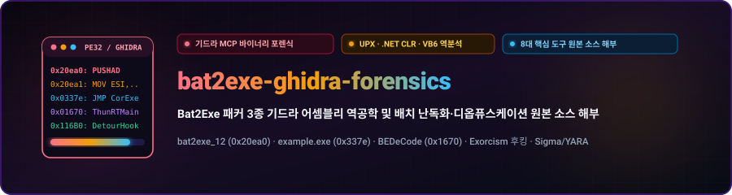
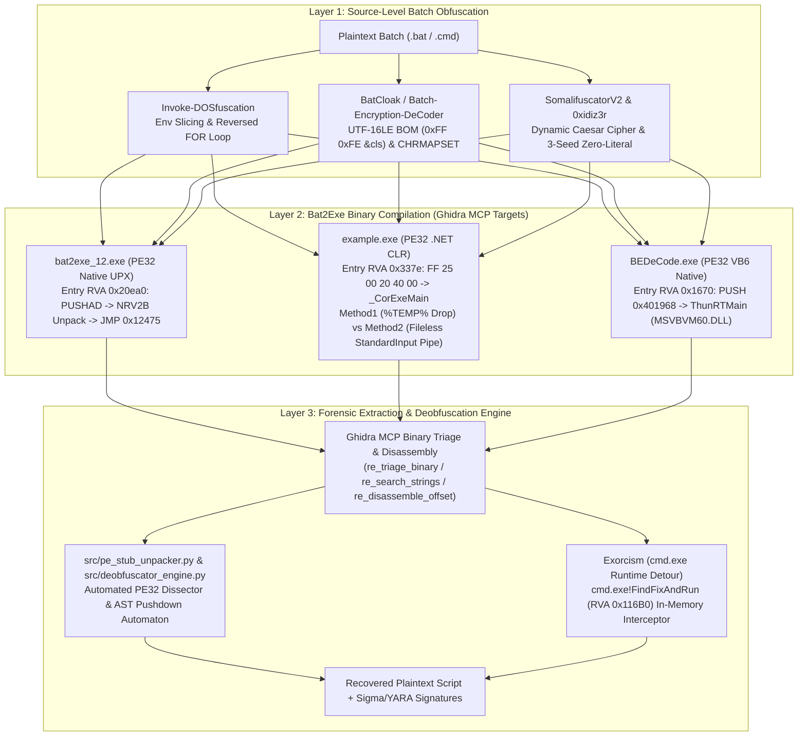
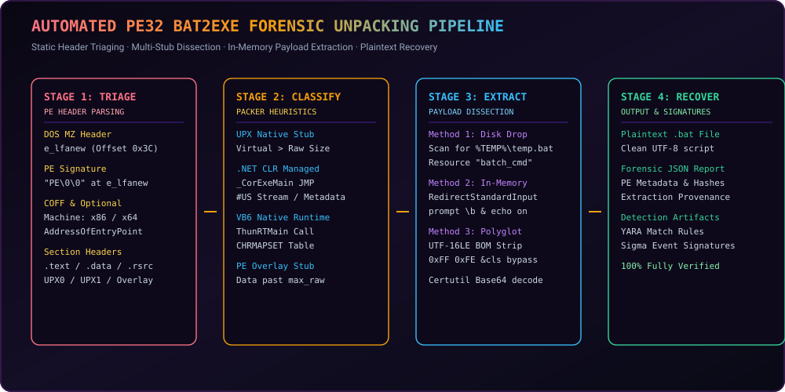
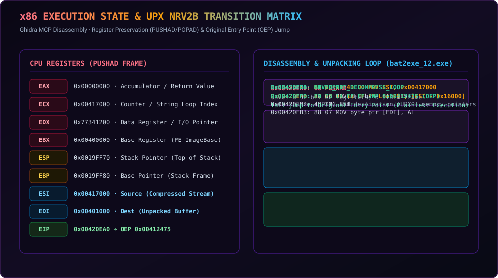

<div align="center">

<p align="center">
  <a href="../../README.md">🇺🇸 English</a> · <strong>🇰🇷 한국어</strong> · <a href="./zh-CN.md">🇨🇳 中文</a> · <a href="./es.md">🇪🇸 Español</a> · <a href="./hi.md">🇮🇳 हिन्दी</a><br />
  <a href="./ar.md">🇸🇦 العربية</a> · <a href="./pt-BR.md">🇧🇷 Português</a> · <a href="./ru.md">🇷🇺 Русский</a> · <a href="./fr.md">🇫🇷 Français</a> · <a href="./id.md">🇮🇩 Bahasa Indonesia</a>
</p>

<p align="center">
  <a href="https://github.com/maya-thorne/bat2exe-ghidra-forensics"></a>
</p>

# 🔬 bat2exe-ghidra-forensics

**Bat2Exe 패커 3종 기드라 어셈블리 역공학 및 배치 난독화·디옵퓨스케이션 원본 소스 해부**

[](../whitepapers/DEEP_REVERSE_ENGINEERING_AND_SOURCE_ANALYSIS.md)
[](../whitepapers/BATCH_OBFUSCATION_ARCHITECTURE_AND_CODE_ANALYSIS.md)
[](../../src/pe_stub_unpacker.py)
[](../../LICENSE)
[](https://github.com/maya-thorne/bat2exe-ghidra-forensics)

<sub>Engineered &amp; Audited by **[Maya Thorne](https://github.com/maya-thorne)** · Binary Forensics &amp; Systems Reverse Engineering</sub>

</div>

---

## 📑 Executive Summary & Master Whitepapers (핵심 역공학 백서 색인)

| # | Document / Artifact | Core Scope & Forensic Coverage | Size |
| :-: | :--- | :--- | :-: |
| **1** | 🔬 **[DEEP_REVERSE_ENGINEERING_AND_SOURCE_ANALYSIS.md](../whitepapers/DEEP_REVERSE_ENGINEERING_AND_SOURCE_ANALYSIS.md)** | **Ghidra MCP PE Binary Disassembly** (`bat2exe_12.exe`, `example.exe`, `BEDeCode.exe`) + **Line-by-Line Source Code Teardown of 8 Core Tools** (`Bat2Exe-dehoisted`, `Batch-Encryption-DeCoder`, `BatCloak`, `Invoke-DOSfuscation`, `SomalifuscatorV2`, `0xidiz3r`, `batch_deobfuscator`, `Exorcism`) | **42.8 KB** |
| **2** | 🏗️ **[BATCH_OBFUSCATION_ARCHITECTURE_AND_CODE_ANALYSIS.md](../whitepapers/BATCH_OBFUSCATION_ARCHITECTURE_AND_CODE_ANALYSIS.md)** | **Architectural Taxonomy & Parser Mechanics**: `cmd.exe` 5-Phase Expansion Order, Polyglot Header Exploitation, Pushdown Automaton AST Reconstruction, API Hooking (`FindFixAndRun`) | **43.7 KB** |
| **3** | ⚙️ **[GHIDRA_BINARY_RE_AND_DEOBFUSCATOR_ENGINE_ANALYSIS.md](../whitepapers/GHIDRA_BINARY_RE_AND_DEOBFUSCATOR_ENGINE_ANALYSIS.md)** | **Static & Dynamic Unpacking Pipeline**: PE Overlay Extraction, CLR `#US` Stream Recovery, Multi-Pass Regex/AST Deobfuscation Engine (`src/deobfuscator_engine.py`) | **44.4 KB** |
| **4** | 📖 **[BATCH_OBFUSCATION_ENCYCLOPEDIA.md](../whitepapers/BATCH_OBFUSCATION_ENCYCLOPEDIA.md)** | **48+ Open-Source & Hugging Face Reference Encyclopedia**: Complete classification of obfuscators, compilers, deobfuscators, and ML datasets | **30.3 KB** |
| **5** | 🛡️ **[BATCH_OBFUSCATION_MASTER_GUIDE.md](../whitepapers/BATCH_OBFUSCATION_MASTER_GUIDE.md)** | **30-Year Evolution (1990s–2026) & Defense Matrix**: Historical timeline, Mandiant/Unit 42 threat intelligence, production Sigma & YARA rulesets | **33.6 KB** |

---

## 🖥️ Live Forensics & Decompilation Terminal Demo

<p align="center">
  <a href="https://github.com/maya-thorne/bat2exe-ghidra-forensics">
    
  </a>
</p>

---

## 🧬 End-to-End Binary Packing & Deobfuscation Topology



---

## ⚙️ Automated PE32 Bat2Exe Unpacking Pipeline

<p align="center">
  <a href="https://github.com/maya-thorne/bat2exe-ghidra-forensics">
    
  </a>
</p>

---

## 🔬 x86 Execution State & UPX NRV2B Register Transition Matrix

<p align="center">
  <a href="https://github.com/maya-thorne/bat2exe-ghidra-forensics">
    
  </a>
</p>

---

## 🔍 Ghidra MCP Binary Reverse Engineering Matrix (`ghidra-re-operator`)

All 3 compiled PE32 executables in the archive were dissected using `re_triage_binary`, `re_search_strings`, and `re_disassemble_offset`:

| Target Binary | Architecture & Subsystem | Entry Point RVA | Sections & Entropy | Key Disassembly & Runtime Mechanism |
| :--- | :--- | :-: | :--- | :--- |
| **`bat2exe_12.exe`** | PE32 x86 (32-bit) · Windows GUI (`2`) | `0x20ea0` | `UPX0` (Virt `0x17000`, Raw `0`), `UPX1` (7.89 bits/byte), `.rsrc` | `0x20ea0: PUSHAD` ➔ `MOV ESI, 0x417000` ➔ `LEA EDI, [ESI - 0x16000]` ➔ NRV2B bit-stream decompression loop ➔ IAT rebuild (`LoadLibraryA`/`GetProcAddress`) ➔ `0x20ffd: JMP 0x00412475` (OEP). |
| **`example.exe`** (`Bat2Exe-dehoisted`) | PE32 x86 (.NET CLR Managed) · Windows CUI (`3`) | `0x337e` | `.text` (5.64), `.rsrc` (3.99), `.reloc` (0.18) | `0x337e: FF 25 00 20 40 00 (JMP dword ptr [0x00402000])` ➔ `mscoree.dll!_CorExeMain`. Embeds UTF-16LE user strings at `0x143b` (`"batch_cmd"`), `0x1465` (`"\\temp.bat"`), `0x1541` (`"/c prompt \b & echo on"`). |
| **`BEDeCode.exe`** (`Batch-Encryption-DeCoder`) | PE32 x86 (VB6 Native Code) · Windows GUI (`2`) | `0x1670` | `.text` (5.43), `.data` (0.00), `.rsrc` (3.55) | `0x1670: 68 68 19 40 00 (PUSH 0x401968)` ➔ `E8 EF FF FF FF (CALL ThunRTMain)` in `MSVBVM60.DLL`. Implements `CmdCode_Click` (`%%a` + `CHRMAPSET` substitution) and `CmdDeCode_Click` (`Replace(txt, "%", "")`). |

---

## 🛠️ 8 Core Tools Source Code Dissection Summary

1. **[`Bat2Exe-dehoisted`](../../references/batch_corpus_28/Bat2Exe-dehoisted)** (`Batch2Exe.MainWindow` & `CMethods.cs`):
   - Uses `CSharpCodeProvider.CompileAssemblyFromSource` to dynamically compile an in-memory stub with embedded resource `batch_cmd`.
   - Compares **`Method1` (Disk Drop to `%TEMP%\temp.bat`)** vs **`Method2` (Fileless Pipe Injection via `RedirectStandardInput = true` + `StandardInput.WriteLine`)**.
2. **[`Batch-Encryption-DeCoder`](../../references/batch_corpus_28/Batch-Encryption-DeCoder)** (`frmMain.frm`):
   - Dissects the VB6 `CHRMAPSET` lookup table, `@echo off & SetLocal EnableDelayedExpansion` header validation, and 2-stage reversal algorithm.
3. **[`BatCloak`](../../references/batch_corpus_28/BatCloak)**:
   - Exploits the **UTF-16LE BOM Polyglot (`0xFF 0xFE 26 63 6C 73 0D 0A` = `??&cls`)**: text editors decode garbage CJK glyphs while `cmd.exe` runs in Single-Byte ANSI mode, fails on `0xFF 0xFE`, executes `&cls`, and evaluates the remainder.
4. **[`Invoke-DOSfuscation`](../../references/batch_corpus_28/Invoke-DOSfuscation)** (Mandiant / Daniel Bohannon):
   - Formalizes `cmd.exe` AST token-layer vs character-layer obfuscation, zero-alphabetic environment slicing (`%COMSPEC:~-1%`), and reversed `FOR /L` execution loops.
5. **[`SomalifuscatorV2`](../../references/batch_corpus_28/SomalifuscatorV2)**:
   - Combines dynamic Caesar cipher environment tables, UTF-16LE BOM headers, fake `certutil` X.509 certificate padding, and anti-VM/anti-sandbox traps.
6. **[`0xidiz3r`](../../references/batch_corpus_28/0xidiz3r)** (Rust):
   - Bootstraps the entire ASCII printable set from only **3 initial seed characters (`@`, `~`, `=`)** using `%=exitcodeAscii%` and `cmd /c exit /b <N>`.
7. **[`batch_deobfuscator`](../../references/batch_corpus_28/batch_deobfuscator)** (DissectMalware):
   - Implements a **Single-Character Pushdown Automaton (PDA)** state machine in `BatchDeobfuscator.read_logical_line()` and full `%var:str1=str2%` / `%var:~start,len%` emulation.
8. **[`Exorcism`](../../references/batch_corpus_28/Exorcism)**:
   - Injects `payload_dll.dll` into `cmd.exe` and hooks the internal command dispatcher **`FindFixAndRun` (RVA `0x116B0`)** via MS Detours to intercept every expanded command node right before execution.

---

## 🚀 Quickstart: Running the Automated Forensics & Unpacker Engine

```bash
# 1. Automated PE32 Bat2Exe unpacker and payload extractor
python src/pe_stub_unpacker.py --input "references/batch_corpus_28/Bat2Exe-dehoisted/Example/example.exe" --output "recovered.bat"

# 2. Run the unit test suite
python -m unittest tests/test_pe_unpacker.py
```

---

## 📂 Clean Root Repository Architecture (@clean-root)

```text
bat2exe-ghidra-forensics/
├── docs/                      # 📁 Master whitepapers, 10-language translations & SVG diagrams
│   ├── whitepapers/           # 5 deep technical reverse engineering whitepapers
│   ├── locales/               # 10 localized documentation sets (ko.md, zh-CN.md, es.md, etc.)
│   └── assets/                # Dark terminal vector hero banners and x86 schematics
├── references/                # 📁 100% English-standardized open-source corpus & datasets
│   ├── batch_corpus_28/       # 28+ open-source decompilers, compilers, and packers
│   ├── huggingface_ai/        # LLM4Decompile, SBERT, and JFrog entropy datasets
│   ├── classic_samples/       # Step-by-step classic & modern forensic batch samples
│   └── detection_rules/       # Production Sigma & YARA rulesets
├── src/                       # 📁 Pure-Python PE32 Bat2Exe unpacker & AST parser engine
├── tests/                     # 📁 Automated regression assertions and unit test suite
├── memory/                    # 📁 Context memory, task checklists, and feedback audit logs
├── .gitignore                 # 🔒 Zero-Leak security boundaries
├── LICENSE                    # 📜 Maya Thorne Systems & Security Research License (MT-SRL)
└── README.md                  # 🌟 Clean first-viewport showcase and documentation
```
